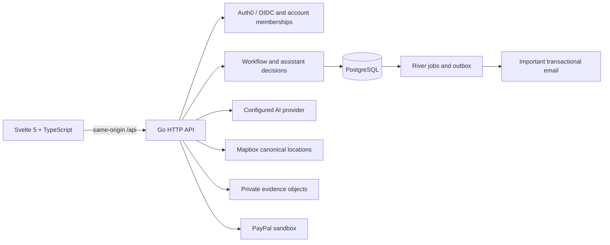

# Architecture

SamenKlaar is a single Go service with a built Svelte frontend. Go owns permissions, workflow transitions, quote arithmetic, reservations, evidence access and payment guards. Browser state is never authoritative for ownership or money movement.

## Modules and persistence

- `cmd/api/` wires providers and exposes explicit migration, configuration, health, email diagnostic and seed commands.
- `internal/httpapi/` authenticates/scopes HTTP operations, validates same-origin mutations, applies rate limits and runs bounded assistant turns through validated workflow actions.
- `internal/identity/` verifies OIDC identities and maps them to opaque server-side sessions and authorized account roles.
- `internal/workflow/` defines state transitions, immutable scope versions, agent decisions and completion/payment guards.
- `internal/adapters/` implements AI, email, Mapbox, PayPal, R2 and PostgreSQL integration.
- `src/features/`, `src/ui/`, `src/lib/` and `src/state/` hold product screens, shared components, client contracts and action orchestration.
- `db/` contains schema/query sources; `internal/adapters/postgres/migrations/` contains ordered embedded migrations. Historical migrations remain necessary for upgrades.

The request journey is a bounded JSON snapshot. Account memberships, professional directory, schedules, reservations, scopes, payment operations, audit records, notification outbox and River jobs have relational records. Transactions and row/advisory locks protect transitions that span these records.

## Account boundaries

Auth0 proves identity; PostgreSQL determines customer, professional and operator permissions. Every workspace, payment, evidence and upload route repeats ownership/assignment checks. Request IDs are routing keys, not access tokens. A professional sees only assigned work and the appropriate shared records; each person's assistant conversation is private to that person.

Operators use audited, reasoned administration for customer/professional access, session revocation and case work. They cannot grant themselves operator access or administer other operators through the ordinary UI. Suspension removes matching eligibility without erasing existing agreements. Location directories aggregate published coverage and demand without exposing private visit/base addresses or coordinates.

## Discovery and booking

The authenticated Mapbox adapter searches Dutch Geocoding v6 results with permanent-storage permission. Account-bound signed selections carry canonical results; client coordinates are ignored. Tokens stay on the server. Professional geographic bases are private; discovery uses a radius and straight-line distance, with broad-result bounds to avoid excluding city-edge providers. Exact visit coverage is checked again in the reservation transaction. Legacy label-based profiles retain their coverage until updated.

Intake clarifies the work, then catalog matching uses actual approved services and schedule/coverage eligibility. Quotes use integer minor units and published service data. The customer explicitly selects and reviews a professional, then confirms price/options before planning continues. Refreshes and assistant sweeps cannot bypass those stages.

Weekly hours, notice, travel buffers, horizon and days off generate free times. Reservations serialize overlapping bookings by professional. Confirmation deadlines use the Europe/Amsterdam business clock. Expiry/decline/cancellation releases the reservation and queues exact-attempt authorization release when needed. Immutable scope snapshots prevent a later price/service edit from changing an agreed job.

## AI and completion evidence

Gemini, OpenAI or Claude can interpret intake/replies and summarize evidence through validated schemas. Free text is untrusted input, not authority to transition money or expand permissions. Private address/coordinates are excluded from evidence-review AI input. Intake photos remain distinct from professional completion evidence.

R2 stores private files. The professional's saved draft and current completion round are checked before submission; missing/unclear documentation stays with the professional for correction. A passed documentation check is not a workmanship or safety certificate. Manual customer approval or scope-bound booking delegation controls completion/payment. See [AGENT_ARCHITECTURE.md](AGENT_ARCHITECTURE.md).

## Payments and background work

PayPal seller onboarding, buyer-approved authorization, capture, full refund and verified webhooks use durable PostgreSQL operation identities. The server repeats scope, amount, seller, consent, authorization and dispute checks before money operations. Lost responses are reconciled using the same idempotency keys. Delegation permits review/capture of an existing buyer-approved hold; it cannot create a fresh authorization. See [PAYMENTS.md](PAYMENTS.md).

River performs durable release, webhook, coordination and notification work. A notification outbox separates in-app updates from the limited email policy. SMTP is optional; important email remains queued until configured. Delivery is at-least-once across a crash window, with stable Message-IDs. Routine assistant/chat updates do not produce email. See [EMAIL.md](EMAIL.md).

## Runtime and deployment

The Docker build compiles frontend and backend together; Go serves `dist/` and `/api`. Caddy supplies HTTPS on the Docker-host path; Render supplies its managed edge. Migrations run before readiness checks. Use one replica: rate limiters, reply caches and per-request agent runner locks are in memory, while state mutations remain protected by PostgreSQL. Shared locking/rate limiting is required before scaling out.

`APP_ENV` is development or production; there is no injected runtime demo identity or simulated payment success. Explicit seed commands prepare fictional accounts separately. PayPal stays sandbox-only in both environments. [SETUP.md](SETUP.md) and [DEPLOYMENT.md](DEPLOYMENT.md) document configuration and repeatable execution.
