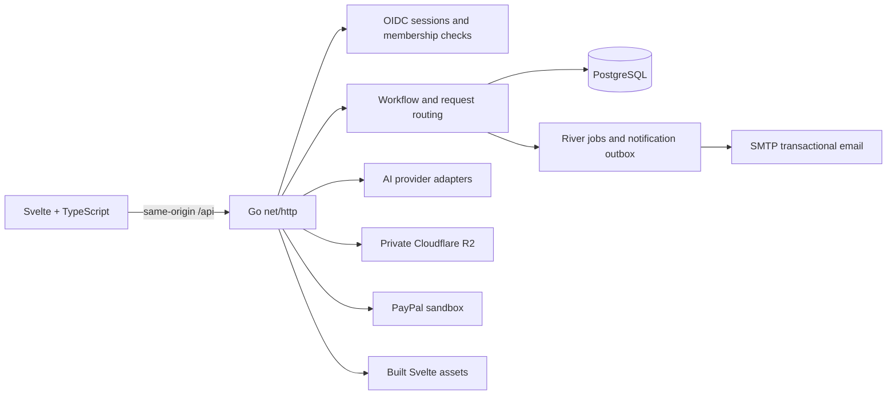

# Architecture

SamenKlaar is a modular service marketplace. Go owns identity-derived permissions, workflow transitions, quote arithmetic, reservations, evidence access and payment preconditions. Svelte presents account workspaces and submits named actions; it is never authoritative for ownership or money state.

## Application boundaries

- `cmd/api/` wires the app, validates runtime configuration, opens PostgreSQL and starts HTTP. It also exposes separate migration, configuration-check, and health-check commands.
- `internal/httpapi/` maps authenticated HTTP requests to workflows, enforces same-origin unsafe requests, applies per-account in-process request limits, scopes job/evidence/payment operations and serves the built frontend. AI-backed routes have a tighter bucket. Public sign-in start and callback routes also use per-client in-process limits; Caddy overwrites `X-Real-IP` from the connection peer. A multi-replica deployment must add an edge or shared-store limiter; the in-process allowance otherwise applies once per replica.
- `internal/identity/` performs OIDC login and maps verified identities to opaque server-side sessions.
- `internal/workflow/` defines domain state, role-aware actions, scope versioning and payment/completion guards. No AI adapter can directly transition payment state.
- `internal/adapters/` contains provider integrations and PostgreSQL persistence.
- `src/features/` holds reusable authentication, customer, professional, operator and request-navigation components. `src/lib/` holds API contracts/client code; `src/state/` owns client state and action orchestration.
- `db/` contains canonical schema and sqlc queries. Runtime migrations are versioned in `internal/adapters/postgres/migrations/`.

The Docker build compiles the static browser assets and Go API together for both local and production deployments. Caddy exposes one origin for the browser, Auth0 callback and API. Vite is a frontend build tool; there is no separate frontend runtime or proxy server.

## Identity and request ownership

Auth0 verifies a person. PostgreSQL memberships determine whether they can act as a customer, professional or operator. Login establishes a single identity with customer access. In-app onboarding adds pending professional membership to that account; operator status must be provisioned by the service owner. The active workspace is an authorized membership, and the account stores its preferred role for future logins. The API replaces client actor claims with the signed-in session role.

`account_workspaces` stores separate request state. A customer sees only rows they own. A professional sees requests whose persisted `job.professionalAccountId` matches their account. State, PayPal, upload, evidence-download and evidence-review routes carry a workspace ID and repeat the owner/assignment check in Go. Request IDs are routing keys, not access tokens.

The workflow still stores the journey snapshot as JSON for a bounded implementation. Identity, professional directory, availability, booking reservations, scope versions, audit events, notification outbox and River jobs use relational tables. A future schema normalization should follow demonstrated query and history needs rather than adding unused tables.

## Service discovery and catalog

Professional profiles and one initial catalog offer per profile are persisted by account. Operators must approve a profile before customer matching. Customers see an offer derived from the provider's service price, call-out, materials policy, exclusions and duration. AI may clarify or suggest a route; Go uses the selected published offer for price arithmetic.

Intake assessment requests proceed to the professional directory; unclear requests receive another chat clarification instead of operator review. Matching excludes the customer’s own profile and orders published availability by the earliest usable slot, filtering expired, too-short and conflicting windows. An urgent request can approve the plan and reserve that earliest visit in one atomic transaction; no visit is booked before customer approval. Providers with no published slots can still discuss dates.

After service clarification, a customer supplies an Amsterdam neighbourhood or postcode area. The directory filters actual catalog providers against their comma-separated published service-area labels. It does not geocode, rank by distance, or claim travel-time accuracy. The customer supplies a full visit address only after selecting a provider; the address is required before plan approval and is stored separately from the public area label. The assigned professional can read it through the owned workspace. Evidence-review requests redact that field before calling an AI provider. Uncovered areas can be saved on the account and appear in the operator queue without inventing a provider or booking.

## Booking and scope

Offers include actual provider availability slots. The API returns currently available windows; booking locks the slot row, checks the persisted time and serializes overlap checks by professional in a database transaction. Appointment times are stored in UTC and retain the professional's timezone for display. A selected time remains reserved for two business hours while the professional confirms it. A shared worker expires unanswered reservations and releases the slot transactionally. Professional cancellation releases the reservation and lets the customer return the saved request to matching.

The lifecycle worker queues deduplicated reminders for a confirmed visit, overdue evidence, completion review, and payment approval. Jobs stalled for 24 hours appear in the operator queue; the system never approves work or moves money automatically. The current operational confirmation hours are weekdays 09:00–17:00 Europe/Amsterdam. Recurring hours, travel buffers and external calendars are not implemented. Scope versions are immutable snapshots; customer approval of a professional-proposed change advances the version and clears completion/payment approvals for the previous scope.

After a job is completed and paid, the customer can leave one 1–5 star rating with an optional comment. The assigned professional can respond once. The review remains attached to that request and is visible to its customer and professional; public profile aggregation, editing, and moderation/reporting are not enabled until product visibility and policy are defined.

## AI, evidence and payments

The configured AI provider (Gemini, OpenAI, or Claude through Anthropic) returns schema-validated intake suggestions and, only after customer action, an evidence coverage summary through a shared provider contract. Provider catalog arithmetic and booking checks remain deterministic. Uploaded evidence is written to a private R2 bucket and accessed through request-authorized API routes. AI review describes documented/missing/unclear coverage; it cannot verify workmanship, compliance or safety. `AI_PROVIDER`, `AI_PROVIDER_KEY`, and `AI_MODEL` configure the integration; credentials remain server-side.

PayPal is sandbox-only. Go creates an authorization order, verifies buyer approval with PayPal, and captures only after current-scope completion and amount approval. Order, authorization, capture and refund IDs plus conditional operation state are stored in PostgreSQL so multiple instances coordinate and uncertain operations can be reconciled after restart. The public webhook handler verifies transmissions with PayPal, stores deduplicated events, and lets River reconcile capture, refund, reversal and dispute events. The operator can initiate full refunds; partial refunds and reversals require manual provider reconciliation. The adapter does not onboard sellers or distribute funds to professionals.

Email updates use a PostgreSQL outbox and River workers. SMTP delivery is configured outside the repository. A stable Message-ID supports recipient-side deduplication where available, but SMTP delivery is at-least-once after an interrupted send. The operator queue exposes aggregate failed, unconfigured, and stale-send counts without recipient contact details or email content. Operators also see stalled-work and provider-reconciliation cases in the authenticated queue; operator email and SMS channels are not configured.

River is PostgreSQL-backed and used for transactional notification enqueueing. When SMTP is configured, a worker resolves the recipient from the workspace, sends a generic request update, and records delivery status. Missing SMTP marks the outbox item `adapter_unconfigured`; transient failures are retried, and stale sends are reclaimed after 15 minutes. Delivery is at-least-once across a process failure window, so duplicate email remains possible. Production startup requires SMTP address and sender configuration. SMS, SSE, and browser push updates are not implemented.

## Runtime configuration

Use `APP_ENV=development` locally and `APP_ENV=production` in the deployment. There is no demo mode. Select an AI integration with `AI_PROVIDER`, provide its key through `AI_PROVIDER_KEY`, and set the provider's model ID with `AI_MODEL`; app branding is configured with `APP_NAME`. PostgreSQL migrations use neutral domain names in the current schema. The first migrations contain historical `relay_*` names because existing installations may need those tables renamed; migration 006 removes the legacy single-state/demo table after data migration.
