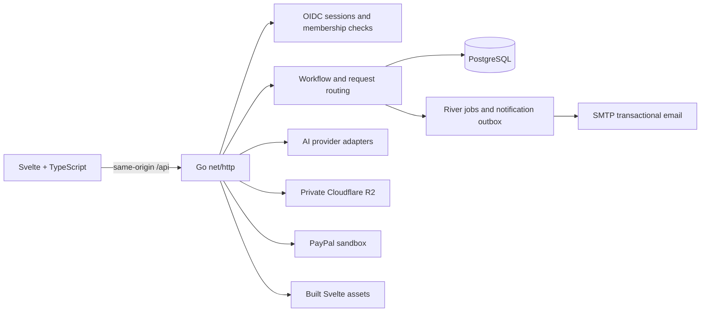

# Architecture

SamenKlaar is a modular service marketplace. Go owns identity-derived permissions, workflow transitions, quote arithmetic, reservations, evidence access and payment preconditions. Svelte presents account workspaces and submits named actions; it is never authoritative for ownership or money state.

## Application boundaries

- `cmd/api/` wires the app, validates runtime configuration, opens PostgreSQL and starts HTTP. It also exposes separate migration, configuration-check, and health-check commands.
- `internal/httpapi/` maps authenticated HTTP requests to workflows, enforces same-origin unsafe requests, applies per-account in-process request limits, scopes job/evidence/payment operations and serves the built frontend. AI-backed routes have a tighter bucket. Public sign-in start and callback routes also use per-client in-process limits; Caddy overwrites `X-Real-IP` from the connection peer. A multi-replica deployment must add an edge or shared-store limiter; the in-process allowance otherwise applies once per replica.
- `internal/identity/` performs OIDC login and maps verified identities to opaque server-side sessions.
- `internal/workflow/` defines domain state, role-aware actions, scope versioning and payment/completion guards. No AI adapter can directly transition payment state.
- `internal/adapters/` contains provider integrations and PostgreSQL persistence.
- `src/features/` holds the customer, professional, operator, public, request, shell and assistant (`agent`) screens; `src/ui/` the shared components (icons, pills, banners, dialogs, stepper); `src/lib/` API contracts, client code and copy; `src/state/` client state and action orchestration. The look is documented in [DESIGN_SYSTEM.md](DESIGN_SYSTEM.md).
- `db/` contains canonical schema and sqlc queries. Runtime migrations are versioned in `internal/adapters/postgres/migrations/`.

The Docker build compiles the static browser assets and Go API together for both local and production deployments. Caddy exposes one origin for the browser, Auth0 callback and API. Vite is a frontend build tool; there is no separate frontend runtime or proxy server.

## Identity and request ownership

Auth0 verifies a person. PostgreSQL memberships determine whether they can act as a customer, professional or operator. Login establishes a single identity with customer access. In-app onboarding adds pending professional membership to that account; operator status must be provisioned by the service owner. The active workspace is an authorized membership, and the account stores its preferred role for future logins. The API replaces client actor claims with the signed-in session role.

`account_workspaces` stores separate request state. A customer sees only rows they own. A professional sees requests whose persisted `job.professionalAccountId` matches their account. State, PayPal, upload, evidence-download and evidence-review routes carry a workspace ID and repeat the owner/assignment check in Go. Request IDs are routing keys, not access tokens.

The workflow still stores the journey snapshot as JSON for a bounded implementation. Identity, professional directory, availability, booking reservations, scope versions, audit events, notification outbox and River jobs use relational tables. A future schema normalization should follow demonstrated query and history needs rather than adding unused tables.

## Service discovery and catalog

Professional profiles and one initial catalog offer per profile are persisted by account. Operators must approve a profile before customer matching. Customers see an offer derived from the provider's service price, call-out, materials policy, exclusions and duration. AI may clarify or suggest a route; Go uses the selected published offer for price arithmetic.

Intake assessment requests proceed to the professional directory; unclear requests receive another chat clarification instead of operator review. Matching excludes the customer’s own profile and orders published availability by the earliest usable slot, filtering expired, too-short and conflicting windows. An urgent request can approve the plan and reserve that earliest visit in one atomic transaction; no visit is booked before customer approval. Providers with no published slots can still discuss dates.

After service clarification, a customer searches by address, postcode, city or neighbourhood. The authenticated Go endpoint proxies Mapbox Geocoding v6 with `country=nl` and `permanent=true`; the server-side token is `MAPBOX_ACCESS_TOKEN`. Suggestions are debounced in the browser, rate-limited per account, and signed for that account for one hour. The server verifies the selection and ignores client-supplied coordinates. A restart invalidates outstanding selections; selecting again recovers.

Professionals save a private geocoded base address or postcode and a 1–100 km travel radius. PostgreSQL filters coverage before candidate limits, then ranks by straight-line distance and availability. Broad postcode/city searches use the closest point of the result bounding box for discovery, so professionals serving a city edge are not excluded by its centre. These are approximate results: the exact visit address must fall inside the professional’s radius before booking, including assistant and negotiated bookings. The reservation transaction repeats that check under the professional lock. Travel time and road distance are not calculated. Existing profiles retain published-label coverage until their owners add a geographic base, and have no fabricated distance.

A customer may supply the full address during search. The exact text is kept separately from the discovery label and shared thread, then supplied to the assigned professional after selection. An address added or changed later is geocoded again, checked against coverage and becomes the location for future matching. Both the address and location coordinates are removed from evidence-review AI input. Uncovered areas can be saved on the account and appear in the operator queue without inventing a provider or booking.

## Booking and scope

Offers include actual provider availability slots. The API returns currently available windows; booking locks the slot row, checks the persisted time and serializes overlap checks by professional in a database transaction. Appointment times are stored in UTC and retain the professional's timezone for display. A selected time remains reserved for two business hours while the professional confirms it. A shared worker expires unanswered reservations and releases the slot transactionally. Professional cancellation releases the reservation and lets the customer return the saved request to matching.

The lifecycle worker queues deduplicated reminders for a confirmed visit, overdue evidence, completion review, and payment approval. The operator queue covers three 24-hour post-work waits: missing evidence after the scheduled visit, completion review after documentation, and separate payment approval. No-show, proposal and abandoned-checkout escalation remain open; the system never approves work or moves money automatically. The intended operational confirmation clock is weekdays 09:00–17:00 Europe/Amsterdam; the current deadline function still uses the appointment display timezone (the Amsterdam business clock is still to do). Recurring hours, travel buffers and external calendars are not implemented. Scope versions are immutable snapshots; customer approval of a professional-proposed change advances the version and clears completion/payment approvals for the previous scope.

After a job is completed and paid, the customer can leave one 1–5 star rating with an optional comment. The assigned professional can respond once. The review remains attached to that request and is visible to its customer and professional; public profile aggregation, editing, and moderation/reporting are not enabled until product visibility and policy are defined.

## AI, evidence and payments

The configured AI provider (Gemini, OpenAI, or Claude through Anthropic) returns schema-validated intake suggestions and, only after customer action, an evidence coverage summary through a shared provider contract. Provider catalog arithmetic and booking checks remain deterministic. Uploaded evidence is written to a private R2 bucket and accessed through request-authorized API routes. AI review describes documented/missing/unclear coverage; it cannot verify workmanship, compliance or safety. `AI_PROVIDER`, `AI_PROVIDER_KEY`, and `AI_MODEL` configure the integration; credentials remain server-side.

PayPal is sandbox-only. Customers may authorize the agreed amount after reserving a visit or wait until after they approve completed work (the default). Before a booking-time authorization succeeds, they can switch to the after-completion path. Booking-time authorization must succeed before the professional can confirm; it does not capture funds. Completion and payment approval remain separate gates for capture in either path. Professionals can complete seller onboarding, and Go verifies seller eligibility before binding an authorization to that professional. Go requests instant disbursement to the verified seller only after current-scope completion and payment approval. Order, authorization, capture and refund IDs plus conditional operation state are stored in PostgreSQL so multiple instances coordinate and uncertain operations can be reconciled after restart. The public webhook handler verifies transmissions with PayPal, stores deduplicated events, and lets River reconcile seller onboarding/revocation, capture, refund, reversal and dispute events. The operator can initiate full refunds; partial refunds and reversals require manual provider reconciliation. Marketplace identifiers are present in the ignored local app configuration, but a real sandbox seller/wallet journey has not been verified; live settlement is not verified or enabled.

Authorization recovery validates the stored workspace, job, scope, amount, currency and seller before projecting a recovered hold into the current booking. PostgreSQL rechecks the exact authorization/request identity under workspace and payment locks. Timing deferral serializes against the same records: a created order is marked `deferred`, while an in-progress or uncertain operation must be reconciled first. No successful timing switch implies a hold was released.

Booking decline, cancellation, approved late cancellation and confirmation expiry enqueue an exact-attempt authorization release in the reservation transaction. River retries settlement/void work with the original provider request IDs; a queued release cannot operate on a replacement attempt. New booking attempts wait for the prior release to settle. Negotiated dates preserve the customer's authorization choice and require authorization before professional confirmation on the early path. An approved scope increase releases the old hold and uses after-completion authorization for the new total, as explained before approval.

Email updates use a PostgreSQL outbox and River workers. SMTP delivery is configured outside the repository. A stable Message-ID supports recipient-side deduplication where available, but SMTP delivery is at-least-once after an interrupted send. The operator queue exposes aggregate failed, unconfigured, and stale-send counts without recipient contact details or email content. Operators also see stalled-work and provider-reconciliation cases in the authenticated queue; operator email and SMS channels are not configured.

River is PostgreSQL-backed and used for transactional notification enqueueing. When SMTP is configured, a worker resolves the recipient from the workspace, sends a generic request update, and records delivery status. Missing SMTP marks the outbox item `adapter_unconfigured`; transient failures are retried, and stale sends are reclaimed after 15 minutes. Delivery is at-least-once across a process failure window, so duplicate email remains possible. Production startup requires SMTP address and sender configuration. SMS, SSE, and browser push updates are not implemented.

## Assistants (agents)

Assistants run inside the API process, not as a separate service. `workflow.DecideAgent` is a pure function
of a request snapshot, a role and a mandate. `httpapi.RunAgents` loops over both people's assistants (at most
10 rounds), asks the AI provider to read a typed reply only when the built-in reading cannot, and applies each
step through `runAction`, the same validated path as a button. It runs after every person's action and in a
30 second sweep of recently active requests. Mandates, the decision log and open questions are in
`agent_mandates`, `agent_decisions` and `agent_escalations`; the chat dialogue state lives in the workspace
state (`agentDialog`, `proDialog`), and assistant messages carry an audience so each side sees only its own
private chat. Server-only fields (`ByAgent`, the dialog update) are excluded from the JSON contract, so a
person cannot post as an assistant. Details: [AGENT_ARCHITECTURE.md](AGENT_ARCHITECTURE.md).

## Operations

The API runs as one replica. The assistants' per-request lock, the reply-reading cache and the rate limiters are in process memory, and a 30 second sweep drives time-based steps; a second replica would not corrupt state (changes are serialized by a PostgreSQL row lock and re-validated by the workflow) but could repeat an AI call or a sweep. An assistant waiting for its person's answer is recorded as an open question (banner and one email); it is not an operator waiting state and no timer nudges it yet. Deployments migrate separately before the app starts and wait for readiness; see `make help` for the local and production commands.

## Runtime configuration

Use `APP_ENV=development` locally and `APP_ENV=production` in the deployment. There is no demo mode. Select an AI integration with `AI_PROVIDER`, provide its key through `AI_PROVIDER_KEY`, and set the provider's model ID with `AI_MODEL`; app branding is configured with `APP_NAME`. PostgreSQL migrations use neutral domain names in the current schema. The first migrations contain historical `relay_*` names because existing installations may need those tables renamed; migration 006 removes the legacy single-state/demo table after data migration.
