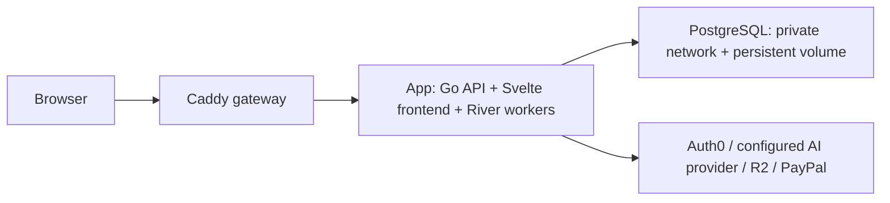

# Deployment

Use one Linux server and Docker Compose. Local and production run the same three containers; production adds a domain and HTTPS. PostgreSQL runs in a container for this single-host setup. No Kubernetes, separate worker fleet, or cloud load balancer is required for the current deployment.



All container configuration and deployment scripts live in `docker/`. Run Make from the repository root; it selects the Compose files in `docker/` and keeps the repository root as the project directory and build context. The Dockerfile-specific ignore file, `docker/Dockerfile.dockerignore`, excludes credentials and generated files from that context.

The frontend is built in `docker/Dockerfile`'s `frontend` stage and copied into the final app image. Go serves the static website and `/api` from one origin. There is no separate frontend container or Vite server in a deployment. A release updates its frontend and backend together.

## Local setup

Install Docker with the Compose plugin and Make. Start the Docker engine, then:

```sh
make init-local
# Edit .secrets/local/app.env with the real provider and Auth0 credentials.
make deploy-local
```

Open **http://localhost:8090**. The gateway binds only to loopback. Neither the app nor PostgreSQL publishes a host port. The frontend and backend are built and run inside Docker; Caddy is the only browser entry point. After code or credential changes, rerun `make deploy-local`.

Initialization generates a random database password once, writes the internal database URL, and uses port 8090 for the app origin and callback. If `.env` exists, local initialization imports its nonempty provider settings without printing them. Subsequent local deployment and validation also fill empty settings from `.env`; nonempty values in `.secrets/local/app.env` take precedence. Database URLs, app origins and Auth0 callbacks are never imported over the generated values. Register `http://localhost:8090/api/auth/callback` and the matching logout origin in Auth0. Fill any remaining credential fields in `.secrets/local/app.env`. Settings are literal `KEY=value` lines, with no shell expansion; runtime environment variables take precedence.

The app currently requires real Auth0, a configured AI provider (Gemini, OpenAI, or Claude through Anthropic), R2, and PayPal settings. Set `AI_PROVIDER`, `AI_PROVIDER_KEY`, and `AI_MODEL` for the same provider. The database container does not replace those services. Preflight reports missing setting names and exits before replacing an app. To start PostgreSQL alone:

```sh
make infra-local
make status-local
```

| Command | Behavior |
| --- | --- |
| `make deploy-local` | Build, validate, start DB, migrate, start app and gateway, verify readiness |
| `make validate-local` | Build and check app configuration and Caddy syntax |
| `make migrate-local` | Build, validate, and run SQL and River migrations |
| `make status-local` | Show containers and health |
| `make logs-local` | Follow bounded container logs |
| `make backup-local` | Write a PostgreSQL custom-format dump under `.backups/local/` |
| `make stop-local` | Stop/remove containers and networks; retain persistent volumes |
| `make check` | Docker build with Go tests/vet and frontend checks, plus deployment orchestration tests |

`make check` runs all Go and frontend checks inside the Docker build. Its
deployment failure/rollback tests use a simulated Docker runner and require
Python 3 on the checking machine. Python is not required to deploy or run the app.

Initialization never overwrites existing configuration or regenerates an existing database password. `POSTGRES_PASSWORD_FILE` sets the password only when the volume is first initialized. Editing the file later does **not** rotate the database password; recover lost credentials or rotate the database role and app URL together.

## Prepare the production server once

Use a Linux host with Docker Engine, Compose, Make, Git, OpenSSL, and curl. Start with roughly 2 vCPUs and 4 GiB RAM and measure actual load. The Compose limits are ceilings, not reserved capacity. Allow TCP 80 and 443 publicly; restrict SSH to administrators. Do not expose ports 5432, 8080, or Caddy's admin port 2019.

Point the domain's A record to the host. Add an AAAA record only if IPv6 actually reaches this host. HTTPS certificate issuance requires working DNS and inbound HTTP/HTTPS. Caddy stores certificates in its persistent `caddy_data` volume.

Check out a reviewed release of this repository in a private directory such as `/srv/samen-klaar`, owned by your deployment user. Run deployment commands **on that server** (or over SSH). This avoids another deployment service or SSH wrapper. Registry login should use a read-only pull credential on the server.

```sh
cd /srv/samen-klaar
make init-prod DOMAIN=app.your-domain.com ACME_EMAIL=you@your-domain.com
# Edit .secrets/prod/app.env; use production Auth0 URLs and sandbox PayPal keys.
# Edit .deploy/prod.env; set APP_IMAGE to the published release digest below.
docker login ghcr.io
```

Production uses `APP_ENV=production` and HTTPS cookies, while payments stay in PayPal sandbox. The app origin must match `DOMAIN`, and the Auth0 callback must be exactly `https://demo.your-domain.com/api/auth/callback`. Register the matching logout origin too. Keep local and server credentials separate.

Authentication configuration uses `AUTH0_ISSUER_URL`, `AUTH0_CLIENT_ID`,
`AUTH0_CLIENT_SECRET`, and `AUTH0_REDIRECT_URI`. Use these names in server secrets
and externally supplied environment variables when deploying the updated app.

Production preflight also requires `PAYPAL_WEBHOOK_ID`, `SMTP_ADDR`, and
`SMTP_FROM` (SMTP username/password are optional but must be set together).
Register the webhook on the PayPal app matching the configured sandbox
credentials and point it to `https://<domain>/api/paypal/webhook`; subscribe to
the capture, refund, reversal, and customer-dispute events listed in
[PAYMENTS.md](PAYMENTS.md). Live PayPal credentials remain unsupported.

The deployment settings in `.deploy/prod.env` contain the domain, certificate email, image digest, and paths. The credential-bearing files live under `.secrets/prod/`. They are mounted read-only through Compose secrets, excluded from Git and Docker build context, and never copied into an image. Compose file secrets retain host permissions: generated files are readable by the non-root container user, but their host parent directories are mode 0700. Docker access is privileged and must be limited to trusted operators.

## Build once and deploy that image

On your development machine or trusted CI runner, commit the release source, log in to the registry, and publish it:

```sh
docker login ghcr.io
make publish IMAGE_REPO=ghcr.io/your-org/samen-klaar
```

The publisher requires a clean Git checkout, runs the checks in the Docker build, tags the image with the full Git commit, and writes the registry digest to `.deploy/release.env`. Production accepts `repository@sha256:<64 hex digits>`, not mutable tags. The default build platform is `linux/amd64`; for an ARM server use `PLATFORM=linux/arm64`, or build both with `PLATFORM=linux/amd64,linux/arm64`.

Copy the `APP_IMAGE` line into the server's `.deploy/prod.env`. Then, on the server:

```sh
make deploy-prod
# From a laptop, the same action is:
ssh your-deploy-host 'cd /srv/samen-klaar && make deploy-prod'
```

Alternatively pass `APP_IMAGE=ghcr.io/your-org/samen-klaar@sha256:...` to `make deploy-prod`. Keep the server checkout at the reviewed release that supplies its deployment files. No secrets are uploaded by the deployment command, and no source is built on the production server.

The flow is:

1. Lock this environment against concurrent deployment commands; validate Compose.
2. Pull the immutable image and the pinned infrastructure images.
3. Run the app's offline configuration check and validate the Caddyfile.
4. Start PostgreSQL and wait for its health check. An existing DB container is never recreated by an application release.
5. Save a database backup, then run `api migrate` as a disposable container. SQL migrations use a version ledger and advisory locks; River migrations run here too.
6. Replace the app, wait for readiness, start/reload Caddy, and check readiness through the public HTTPS endpoint.
7. Record the successful image and the previous successful image.

If build, preflight, backup, or migration fails, the existing app is left running. If the app replacement or final traffic check fails, the script attempts to restore the previous successful image and still exits nonzero. On a first deployment there is no previous image to restore. Inspect status and logs.

This is a **single-host deployment with a brief restart window**, not high availability or guaranteed zero downtime. If the host fails, all three containers are affected.

## Rollback and data recovery

```sh
make status-prod
make logs-prod
make rollback-prod
make backup-prod
```

Rollback restores the previous app image and checks public readiness. It does not reverse migrations or revert secrets, deployment files, or the database volume. Use additive, backward-compatible migrations while both old and new app versions may run. Remove old columns only in a later release after the rollback window. The same requirement applies to River schema upgrades. Changes to gateway or secret configuration need their own reviewed reversal.

Backups are custom-format PostgreSQL dumps under `.backups/prod/` with private permissions. Copy them off the server after each production deployment; schedule daily off-host copies and monitor success. A dump on the same server does not protect against host or disk loss. Define retention and delete old copies deliberately; this repository does not silently prune them.

Test recovery on a separate database, never on the running deployment's only database:

```sh
# Example on the server: create an isolated restore-check database.
docker compose --project-directory . --env-file .deploy/prod.env -f docker/compose.yaml -f docker/compose.prod.yaml exec -T db createdb -U relay restore_check
docker compose --project-directory . --env-file .deploy/prod.env -f docker/compose.yaml -f docker/compose.prod.yaml exec -T db pg_restore -U relay -d restore_check --exit-on-error < .backups/prod/YOUR_BACKUP.dump
# Inspect tables and expected records before dropping restore_check.
```

For an actual recovery, stop the app/worker, restore to a clean replacement database, verify it, update the app database URL if necessary, and redeploy the matching application image. Do not run `down -v` or overwrite the only working volume. Keep database upgrades separate from app releases: take an off-host backup, test restore/compatibility, schedule downtime, and upgrade deliberately. Changing the Compose database image alone does not upgrade an existing container.

## Traffic, health, and Go practices

Caddy is the HTTPS entry point and reverse proxy. It also provides the load balancing boundary; the deployment currently has one upstream (`app:8080`), so no second load balancer is useful yet. Its active checks use `/api/health/ready`. No proxy retry policy is enabled, which avoids automatically replaying payment mutations. Caddy's admin endpoint stays inside its container. TLS terminates at Caddy; app/database traffic stays on the host's private Docker networks.

The database network is internal. The app also joins the edge network for outbound provider calls. PostgreSQL has no outbound internet route through that network. Initial database setup uses one database owner role for app and migrations; split migration and runtime privileges before operating a real production service.

- Go serves static assets and API together and runs a small embedded River worker. Account/session/job state is persisted in PostgreSQL; there is no sticky-session requirement from deployment-local memory.
- Ordered SQL and River migrations are a separate deployment command. App startup never applies migrations; `make deploy-local` and `make deploy-prod` run them before starting the app.
- `/api/health/live` checks the HTTP process. `/api/health/ready` (and `/api/health`) verifies required adapters, a bounded database ping, and that shutdown has not begun. Probes do not call Auth0, the AI provider, R2, or PayPal on every request or disclose secrets.
- SIGTERM withdraws readiness, drains HTTP for up to 45 seconds, and then closes workers and the database pool. Compose allows 60 seconds before forced termination.
- HTTP timeouts, a 1 MiB header limit, a 20 MB ingress body limit, and a 10-connection pool bound resource use. External calls have their own adapter timeouts.
- Public sign-in start and callback routes have short-lived, in-memory per-client token buckets. Caddy overwrites `X-Real-IP` using the connecting client's address before proxying, so the app does not trust a client-supplied forwarding header. Authenticated API limits are per account. Both limiters are local to one app process; use a shared limiter and broader edge controls before running multiple replicas or exposing additional unauthenticated expensive routes.
- The final app image is distroless, runs as non-root, has a read-only filesystem, drops capabilities, and contains no package manager or shell. Build stages run Go tests/vet and frontend checks/build. Base images and infrastructure images are pinned by digest; review and refresh those pins regularly for security updates.
- Startup/error logs use JSON. Container logs rotate at three 10 MB files per container. Compose restarts crashed processes, but does not automatically restart a merely unhealthy container. Monitor public readiness, host disk, memory, backup success, and certificate renewal; investigate unhealthy status with logs.

## When deployment needs grow

First move PostgreSQL to a managed database with verified TLS and automated backups, replacing `DATABASE_URL` and removing the `db` service/network dependency. Then run explicit app replicas behind Caddy with readiness checks, budget total database connections and River concurrency (two workers per app), and test rollout compatibility. A managed load balancer and multiple hosts become useful when host-level availability is required. Area-label matching is an application feature; geocoding, maps, and travel-time routing are not currently configured.

This setup deploys the existing application; its documented business release gaps (including live-money readiness) remain in [IMPLEMENTATION.md](IMPLEMENTATION.md).

## References

- [Docker Compose in production](https://docs.docker.com/compose/how-tos/production/)
- [Compose startup order and health checks](https://docs.docker.com/compose/how-tos/startup-order/)
- [Compose secrets](https://docs.docker.com/compose/how-tos/use-secrets/)
- [Caddy automatic HTTPS](https://caddyserver.com/docs/automatic-https)
- [Caddy reverse proxy and health checks](https://caddyserver.com/docs/caddyfile/directives/reverse_proxy)
- [Go HTTP graceful shutdown](https://pkg.go.dev/net/http#Server.Shutdown)
